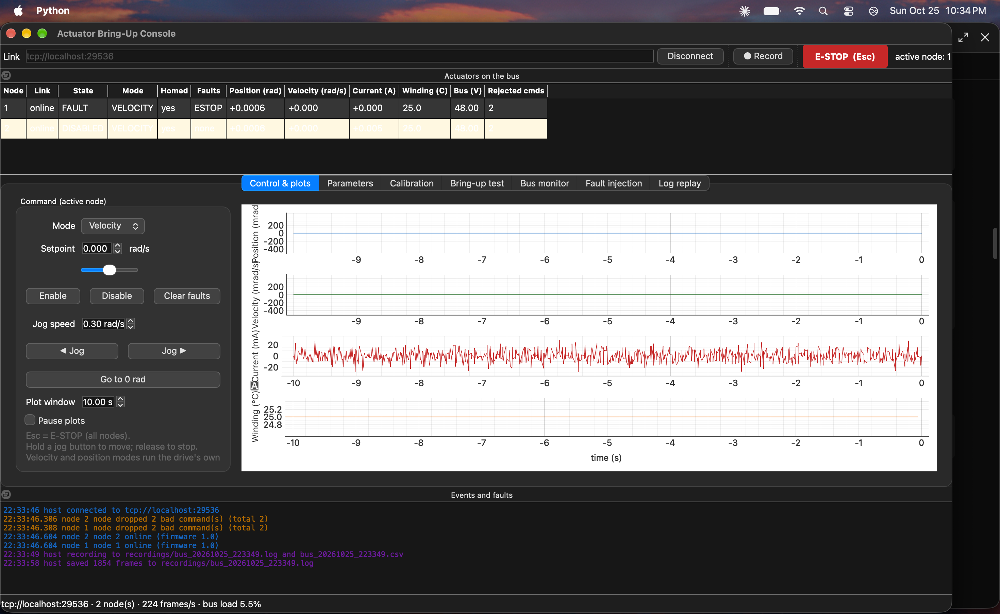

# Actuator Bring-Up & Diagnostics Console

A desktop tool for bringing up, configuring, calibrating, testing and troubleshooting the CAN smart actuators (motor + gearbox + encoder + drive) in a robot's joints, plus the actuator firmware it talks to and a ROS 2 driver for the same actuators.


<!-- Take a screenshot of the console (Cmd+Shift+4, then Space, then click the window) and save it as docs/console.png -->

```
 ┌──────────────── Mac ─────────────────┐            ┌──── ROS 2 Humble (Docker) ────┐
 │  Bring-up console (PySide6)          │            │  actuator_driver (rclpy)      │
 │  control · plots · parameters ·      │            │  /joint_states  /diagnostics  │
 │  calibration · bring-up test ·       │            │  ~/commands  ~/enable ...     │
 │  bus monitor · fault injection ·     │            └──────────────┬────────────────┘
 │  recording · log replay              │                           │
 └──────────────────┬───────────────────┘                           │
                    │ SLCAN (CAN frames over TCP or USB serial)     │
        ┌───────────┴───────────────────────────────────────────────┴──┐
        │ actuator_sim: C++17 firmware for 2 joints on a virtual 500 kbit/s CAN bus │
        │ (same core also builds for an ESP32 over USB serial)                       │
        └────────────────────────────────────────────────────────────────────────────┘
```

## What is in it

| Part | What it does |
| --- | --- |
| `protocol/actuator.dbc` | The interface spec: CANopen-style IDs, rates, scaling, E2E protection (CRC-8 + alive counter) |
| `firmware/` | C++17 actuator firmware: cascaded current/velocity/position control at 1 kHz, command watchdog, latched faults (overcurrent, overtemp, undervoltage, following error, overspeed, encoder, stall, E-stop), parameter table with save-to-flash, SLCAN link. Runs a motor/gearbox/encoder/thermal model so it works with no hardware. GoogleTest unit tests. |
| `console/` | Python console: PySide6 GUI and a CLI over one core (DBC codec, SLCAN link, device manager with a 100 Hz command stream, parameter client, calibration routines, 13-check automated bring-up test, candump recorder, log analysis) |
| `ros2_driver/` | ROS 2 Humble driver node: `/joint_states`, `/diagnostics`, forward-controller-style `~/commands`, enable/disable/clear-faults/E-stop services |
| `firmware/esp32/` | The same firmware core on an ESP32, talking SLCAN over USB serial |
| `.github/workflows/ci.yml` | Builds and tests everything: firmware on Linux + macOS (and under ASan/UBSan), console + simulator integration + GUI (offscreen Qt), ESP32 compile, ROS 2 driver end to end in Docker. Uploads the bring-up reports. |

The simulated joints hide real bring-up problems on purpose: unknown current-sensor offsets (+120 mA, −80 mA), joints that do not start at zero, and **reversed motor wiring on joint 2**. The automated bring-up test finds and fixes all of them before closed-loop control is enabled.

## Quick start (macOS)

```bash
brew install cmake
cmake -S firmware -B firmware/build && cmake --build firmware/build -j
ctest --test-dir firmware/build                     # firmware unit tests

python3 -m venv .venv && source .venv/bin/activate
pip install -e "./console[gui,dev,serial]"

./firmware/build/actuator_sim                       # terminal 1: two simulated actuators
bringup-gui --connect                               # terminal 2: the console
bringup test --report-dir reports                   # or: headless bring-up of every joint
pytest console/tests                                # full test suite (needs the simulator built)
```

## Results

### Bring-up report: node 1

Started 2026-10-25 22:22:54, firmware 1.0, took 21.0 s.
**Result: PASS** (node 1: 13/13 checks passed).

| # | Check | Result | Measured | Limit | Note |
| --- | --- | --- | --- | --- | --- |
| 1 | Heartbeat and firmware | PASS | firmware 1.0, node_id 1 | heartbeat + node_id matches |  |
| 2 | Status message rates | PASS | STATUS_FAST 100 Hz, STATUS_SLOW 10.0 Hz | 100 +-10 Hz, 10 +-2 Hz |  |
| 3 | Parameter write/read-back | PASS | wrote 0.6, read 0.600; out-of-range write refused | exact read-back, bad write refused |  |
| 4 | Supply voltage and temperature | PASS | bus 48.00 V, winding 25.0 C | 44-52 V, 0-60 C |  |
| 5 | Current-sensor offset | PASS | found +119.9 mA, residual +1.4 mA | |residual| < 10 mA | offset written to current_offset |
| 6 | Motor direction | PASS | +current moves the joint +: correct (breakaway at 0.21 A) | +current -> +motion |  |
| 7 | Homing to hard stop | PASS | hard stop found after 3.25 rad of travel; zero set (encoder_offset -0.6890 rad, joint now reads -2.5000 rad) | stall detected, reads homing_position +-0.01 rad |  |
| 8 | Velocity tracking | PASS | RMS error 0.0015 rad/s at 1.0 rad/s | < 0.05 rad/s |  |
| 9 | Position step response | PASS | 0.5 rad step: rise 270 ms, overshoot 0.0%, settling 511 ms, error 0.00 mrad | overshoot < 10%, settling < 1.0 s, error < 5 mrad |  |
| 10 | Command watchdog | PASS | faulted 102 ms after the last command | 100-150 ms |  |
| 11 | E-stop | PASS | output off, fault reported 0.2 ms after the E-stop frame | < 20 ms |  |
| 12 | Corrupted commands rejected | PASS | node counted 2 rejected frame(s) | exactly 2 (bad CRC + repeated counter) |  |
| 13 | Faults clear, calibration saved | PASS | state DISABLED, faults none, winding 25.1 C (peak 25.1 C) | DISABLED, no faults, saved to flash | parameters saved to flash |

### Bring-up report: node 2

Started 2026-10-25 22:27:28, firmware 1.0, took 18.7 s.
**Result: PASS** (node 2: 13/13 checks passed).

| # | Check | Result | Measured | Limit | Note |
| --- | --- | --- | --- | --- | --- |
| 1 | Heartbeat and firmware | PASS | firmware 1.0, node_id 2 | heartbeat + node_id matches |  |
| 2 | Status message rates | PASS | STATUS_FAST 100 Hz, STATUS_SLOW 10.0 Hz | 100 +-10 Hz, 10 +-2 Hz |  |
| 3 | Parameter write/read-back | PASS | wrote 0.6, read 0.600; out-of-range write refused | exact read-back, bad write refused |  |
| 4 | Supply voltage and temperature | PASS | bus 48.00 V, winding 25.0 C | 44-52 V, 0-60 C |  |
| 5 | Current-sensor offset | PASS | found -79.8 mA, residual +0.9 mA | |residual| < 10 mA | offset written to current_offset |
| 6 | Motor direction | PASS | motor ran backwards (phases swapped): set motor_polarity to -1; re-test passes (breakaway at 0.22 A) | +current -> +motion | motor phases swapped: motor_polarity set to -1 |
| 7 | Homing to hard stop | PASS | hard stop found after 2.08 rad of travel; zero set (encoder_offset +0.4110 rad, joint now reads -2.5000 rad) | stall detected, reads homing_position +-0.01 rad |  |
| 8 | Velocity tracking | PASS | RMS error 0.0014 rad/s at 1.0 rad/s | < 0.05 rad/s |  |
| 9 | Position step response | PASS | 0.5 rad step: rise 280 ms, overshoot 0.0%, settling 517 ms, error 0.00 mrad | overshoot < 10%, settling < 1.0 s, error < 5 mrad |  |
| 10 | Command watchdog | PASS | faulted 102 ms after the last command | 100-150 ms |  |
| 11 | E-stop | PASS | output off, fault reported 0.3 ms after the E-stop frame | < 20 ms |  |
| 12 | Corrupted commands rejected | PASS | node counted 2 rejected frame(s) | exactly 2 (bad CRC + repeated counter) |  |
| 13 | Faults clear, calibration saved | PASS | state DISABLED, faults none, winding 25.1 C (peak 25.1 C) | DISABLED, no faults, saved to flash | parameters saved to flash |


## ROS 2

```bash
docker build -f docker/ros2.Dockerfile -t actuator-ros2 .
docker run --rm -it --name actuator-ros2 actuator-ros2       # simulator must be running on the Mac
docker exec -it actuator-ros2 /entrypoint.sh ros2 topic echo /diagnostics
```

## Design notes

- **The DBC is the contract.** The firmware mirrors it in C++; the console decodes from it directly. Golden frames packed by the C++ code are checked byte for byte in Python, and every message is cross-checked against cantools.
- **Safety in the actuator, not the host.** The drive disables itself if commands stop for `cmd_timeout_ms` (default 100 ms), rejects commands with a bad CRC or a repeated counter, and latches faults until they are cleared and their cause is gone.
- **Bring-up order matters.** Zero the current sensor with the motor off, prove the motor direction with a breakaway current ramp (not a closed loop, which would run away if the wiring is reversed), home against the hard stop with a reduced current limit, and only then tune and test motion.
